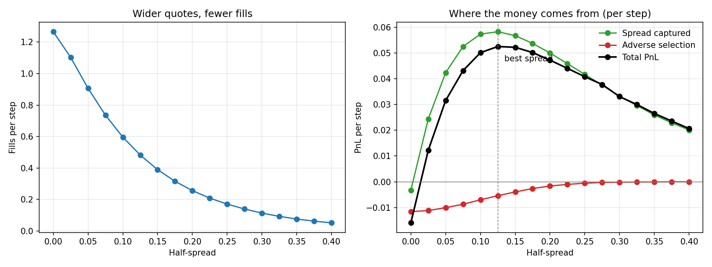

# Market-making simulator

A toy market maker that quotes a bid and an ask, gets traded against by **noise traders** (who pay the spread) and **informed traders** (who know where the price is going), and manages its inventory.
The question it answers: **how wide should you quote?**



## The model (`mm.py`)

Each step:

1. The maker quotes `bid/ask = center ∓ half_spread`, where `center = mid − skew × inventory`. When long, it shades both quotes down, to sell more and buy less.
2. **Noise traders** hit each side with probability `0.6 × exp(−8 × distance from mid)`, so tighter quotes win more of their flow.
3. An **informed trader** arrives 15% of the time, already knows the next price move, and trades only when that move crosses the maker's quote.
4. The mid moves by a random step (standard deviation 0.10).

PnL splits **exactly** into three parts (checked in the tests):

| Part | Meaning |
|---|---|
| Spread captured | Mid minus fill price on every fill: what quoting wide earns |
| Adverse selection | The price move right after each fill, signed against the maker: what informed flow costs (a one-step markout) |
| Inventory PnL | Old position × price move: the cost of holding risk |

## Results (6 seeds × 20,000 steps per point)

**The spread tradeoff.** Quoting at the mid (half-spread 0) fills 1.27 times per step but **loses money**: informed traders pick it off.
Widening the spread filters them out, and adverse selection falls from −0.012 to about 0 per step. But fills drop off exponentially: 0.05 per step at a half-spread of 0.40.
Total PnL is hump-shaped and peaks at a **half-spread of 0.125**, a bit more than one step of price volatility.

| Half-spread | Fills/step | Spread captured | Adverse selection | PnL/step |
|---:|---:|---:|---:|---:|
| 0.000 | 1.27 | −0.003 | −0.012 | **−0.016** |
| 0.050 | 0.91 | 0.042 | −0.010 | 0.032 |
| **0.125** | 0.48 | 0.058 | −0.005 | **0.053** |
| 0.250 | 0.17 | 0.042 | −0.001 | 0.041 |
| 0.400 | 0.05 | 0.020 | 0.000 | 0.021 |

(Spread captured is slightly negative at 0 because the inventory skew moves quotes off the mid.)

**Inventory control.** Same best spread, 12 independent runs each:

| Skew | Mean PnL/step | Worst run | Best run | Inventory std | Max \|inventory\| |
|---:|---:|---:|---:|---:|---:|
| 0 (none) | 0.043 | **−0.096** | 0.086 | 35.9 | 209 |
| 0.01 | 0.052 | 0.050 | 0.055 | 2.2 | 10 |
| 0.03 | 0.050 | 0.049 | 0.052 | 1.3 | 6 |

Without skew, inventory wanders up to 209 units, and the outcome becomes a bet on direction: one run loses money even though the quoting is profitable.
A small skew keeps inventory within ±10 and makes every run land within a narrow band, for almost no cost in average PnL.
Skew more aggressively (0.03) and inventory gets even tighter, but you give up a little edge by quoting off the mid more often.

## Run it

```bash
pip install -r requirements.txt
python mm.py            # prints both tables, writes spread_tradeoff.png (about 2 minutes)
python -m pytest -q
```

The tests check that: without informed flow, adverse selection is ~0 and the spread is pure profit; quoting at the mid loses to informed traders; wider quotes fill less and get picked off less; the three PnL parts add up exactly; and skew shrinks inventory.

## What a real desk adds

This is deliberately a toy. Real market making on options adds: quoting many strikes at once and hedging net delta in the underlying; learning which flow is informed from what happens after each trade; queue position and latency; fees and rebates; and inventory limits that widen quotes as risk grows.
The model is closest in spirit to Glosten–Milgrom (spreads exist because of informed traders) plus the inventory skew from Avellaneda–Stoikov.
